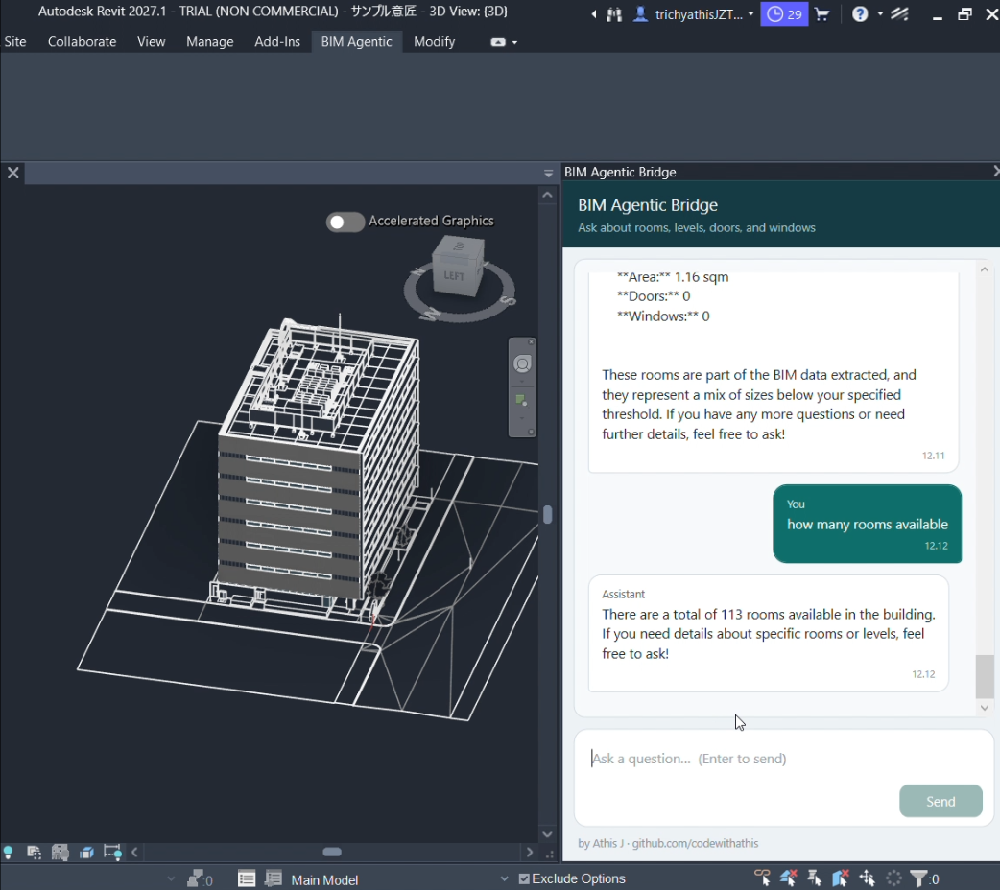

# BIM Agentic Bridge

**Ask your Revit model questions in plain English — get answers grounded in live BIM data.**

BIM Agentic Bridge is an AI-powered Revit plugin that turns room, level, door, and window data into a conversational assistant inside Autodesk Revit. Architects, BIM managers, and project teams can query the active model without building schedules or exporting spreadsheets first.



*Demo: docked **BIM Agentic Bridge** chat in Revit 2027, answering natural-language questions from extracted model data.*

---

## Product overview

| | |
|---|---|
| **Product** | BIM Agentic Bridge |
| **Platform** | Autodesk Revit 2027 (.NET 10 add-in) + local FastAPI AI agent |
| **Author** | [Athis J](https://github.com/codewithathis) |
| **Contact** | [trichyathis@gmail.com](mailto:trichyathis@gmail.com) · [LinkedIn](https://www.linkedin.com/in/athis-j) |

### What it does

1. **Chat inside Revit** — Dockable WPF panel on the **BIM Agentic** ribbon tab.
2. **Extract model data** — Uses the Revit API (`FilteredElementCollector`) to export rooms (name, number, level, area), door/window counts, and levels — including loaded linked models.
3. **Answer with AI tools** — A local FastAPI agent uses OpenAI function calling to query the export and reply in natural language.
4. **Stay in sync** — If data is missing or stale, the agent requests a fresh extraction; the plugin refreshes and retries automatically (with timeout protection).

### Who it is for

- Architecture / interior firms using Revit daily  
- BIM managers validating room inventories and openings  
- Design QA / assessment workflows (“how many rooms?”, “doors on Level 2?”)  
- Consultancies pitching AI + BIM productivity tools  

### Key benefits

- **Faster answers** — No schedule setup for common room questions  
- **Grounded in the model** — Answers come from extracted JSON, not invented counts  
- **In-context UX** — Chat stays docked next to the 3D/plan view  
- **Local-first agent** — Backend runs on your machine; you control the OpenAI key  
- **Extensible** — Tool-based agent design can grow to more BIM queries  

### Example questions

- How many rooms are available?  
- How many rooms are on Level 1?  
- How many doors / windows in room 101?  
- List levels in this model  
- Which rooms have no windows?  

---

## Architecture

```
Revit WPF Chat  →  POST /chat  →  OpenAI tools agent
       ↑                              │
       │                     query_room_data tool
       │                              ↓
  FilteredElementCollector → %LOCALAPPDATA%\BimAgenticBridge\data.json
```

When the agent needs room data and the JSON is missing or stale, it returns `extraction_required`. The plugin extracts on the Revit API thread (45s timeout), writes `data.json`, and retries with `data_ready: true`.

Backend collaborators: `DataReadinessPolicy`, `ToolExecutor`, and `ToolLoop` (orchestrated by `ChatAgent`).

### Design patterns

Client–server · MVVM · Command · Agent + Tools · DTO · ExternalEvent marshaling · layered modules  

---

## Commercial / licensing inquiry

For pilots, licensing, or custom features (more element categories, company branding, multi-version Revit support, on-prem LLM), contact:

**Athis J** — [trichyathis@gmail.com](mailto:trichyathis@gmail.com) · [GitHub](https://github.com/codewithathis) · [LinkedIn](https://www.linkedin.com/in/athis-j)

---

## For technical evaluation — run it yourself

| Requirement | Notes |
|-------------|--------|
| Windows 10/11 | Revit is Windows-only |
| Autodesk Revit **2027** | API DLLs + runtime host |
| .NET **10** SDK (x64) | `C:\Program Files\dotnet\dotnet.exe --list-sdks` |
| Python **3.11+** | Backend agent |
| OpenAI API key | Your own key in `backend/.env` |

### 1) Backend

```powershell
cd backend
python -m venv .venv
.\.venv\Scripts\Activate.ps1
pip install -r requirements.txt
copy .env.example .env
```

Edit `backend/.env`: set `OPENAI_API_KEY`. Leave `DATA_JSON_PATH` empty for `%LOCALAPPDATA%\BimAgenticBridge\data.json`.

```powershell
uvicorn app.main:app --reload --host 127.0.0.1 --port 8000
```

- Health: `GET http://127.0.0.1:8000/health`  
- About: `GET http://127.0.0.1:8000/about`  
- Tests: `pytest`

### 2) Revit plugin

```powershell
# Close Revit first (it locks the DLL)
powershell -ExecutionPolicy Bypass -File .\scripts\build-plugin.ps1
```

Or build manually, then:

```powershell
powershell -ExecutionPolicy Bypass -File .\scripts\install-addin.ps1
```

1. Start **Revit 2027** → **BIM Agentic** → **AI Chat**  
2. Open an **Architectural** model with rooms (e.g. Snowdon Towers Sample Architectural)  
3. Ask: `How many rooms are available?`

Shared path: `%LOCALAPPDATA%\BimAgenticBridge\data.json`

---

## Repository layout

| Path | Purpose |
|------|---------|
| `revit-plugin/` | C# .NET 10 Revit 2027 add-in |
| `backend/` | FastAPI agent (`POST /chat`) |
| `scripts/build-plugin.ps1` | Build + install add-in |
| `scripts/install-addin.ps1` | Write `.addin` for Revit 2027 |
| `Screenshot_1.png` | Product screenshot |
| `AUTHORS.md` | Author credits |

## Chat API contract

`POST /chat`

```json
{ "message": "How many doors in room 101?", "force_extract": false, "data_ready": false }
```

| status | meaning |
|--------|---------|
| `ok` | Natural-language answer in `reply` |
| `extraction_required` | Plugin must export, then retry with `data_ready: true` |

## Configuration

| Variable | Default | Notes |
|----------|---------|-------|
| `OPENAI_API_KEY` | _(empty)_ | Required for `/chat` |
| `OPENAI_MODEL` | `gpt-4o-mini` | Chat model |
| `DATA_JSON_PATH` | `%LOCALAPPDATA%\BimAgenticBridge\data.json` | Must match plugin |
| `DATA_TTL_SECONDS` | `300` | Stale threshold before re-extract |

## Credits

Developed by **[Athis J](https://github.com/codewithathis)**.  
Contact: [trichyathis@gmail.com](mailto:trichyathis@gmail.com) · [LinkedIn](https://www.linkedin.com/in/athis-j)
